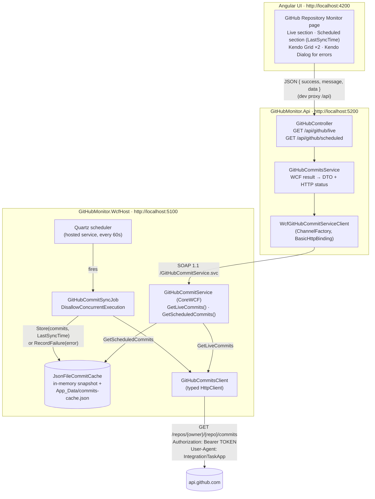

# GitHub Repository Monitor

An end-to-end integration across five layers:

```
Quartz Job ──► GitHub API ──► Cache ──► WCF ──► ASP.NET Core API ──► Angular (Kendo Grid)
```

| Layer | Technology | Location |
|---|---|---|
| WCF service | CoreWCF 1.9 (SOAP, `BasicHttpBinding`) on .NET 8 | [src/GitHubMonitor.WcfHost](src/GitHubMonitor.WcfHost) |
| Scheduler | Quartz.NET 3.x (hosted service, every 60s) | [src/GitHubMonitor.Core/Scheduling](src/GitHubMonitor.Core/Scheduling) |
| GitHub integration + cache | Typed `HttpClient`, in-memory + JSON-file cache | [src/GitHubMonitor.Core](src/GitHubMonitor.Core) |
| REST API | ASP.NET Core 8 Web API + WCF client (`System.ServiceModel.Http`) | [src/GitHubMonitor.Api](src/GitHubMonitor.Api) |
| Front end | Angular 20 + Kendo UI for Angular 26 (Grid, Dialog, Buttons) | [client/github-monitor-ui](client/github-monitor-ui) |
| Tests | xUnit (47 tests) + Jasmine/Karma (8 tests) | [tests/GitHubMonitor.Tests](tests/GitHubMonitor.Tests), `*.spec.ts` |

---

## 1. Architecture overview



### Key design decisions

- **The Quartz scheduler runs inside the WCF host process.** The job and `GetScheduledCommits()` share one cache instance, so there is no inter-process synchronisation. The cache is also written to a JSON file, so it survives restarts and can be inspected.
- **`GitHubMonitor.Core` is host-agnostic.** The GitHub client, cache and job live in a class library with no WCF dependency. You could move the scheduler into a Windows Service or worker without changing it.
- **Expected failures travel as data, not SOAP faults.** `CommitQueryResult` carries `Success`, `ErrorCode` (`Unauthorized`, `Timeout`, `RateLimited`, `NotFound`, …) and `Message`, so the API can map each one precisely. SOAP faults are reserved for real bugs.
- **The API has no assembly reference to the WCF service.** Its WCF contract ([GitHubCommitServiceContract.cs](src/GitHubMonitor.Api/Wcf/GitHubCommitServiceContract.cs)) mirrors the WSDL, the way `dotnet-svcutil` output would. An end-to-end test starts a real CoreWCF host and calls it with the API client to prove the two sides are wire-compatible.
- **Stale-while-error.** When a scheduled sync fails, the last good commits stay in the cache and are flagged `isStale: true`, together with the failure reason. The UI shows a warning banner instead of an empty grid.

---

## 2. Prerequisites

| Tool | Version used |
|---|---|
| .NET SDK | 8.0 or later (projects target `net8.0`; built with SDK 10) |
| Node.js | 20.19+ (required by Angular 20) |
| npm | 10+ |
| A GitHub token | Read access to the target repository (see §4) |
| *(optional)* Kendo UI license key | Removes the trial banner and watermark (see §7) |

---

## 3. How to run

### Option A: everything at once (Windows PowerShell)

```powershell
./run-all.ps1 -Token <YOUR_GITHUB_TOKEN>
```

This builds the solution, then opens three windows: the WCF host with Quartz, the API, and the Angular dev server at http://localhost:4200.

### Option B: each part separately

**1) WCF service + Quartz scheduler** (port 5100)

```bash
# one-time: store the token outside the repo (see §4)
dotnet user-secrets set "GitHub:Token" "<YOUR_GITHUB_TOKEN>" --project src/GitHubMonitor.WcfHost

dotnet run --project src/GitHubMonitor.WcfHost
```

| URL | What |
|---|---|
| http://localhost:5100/GitHubCommitService.svc | WCF endpoint (BasicHttpBinding) |
| http://localhost:5100/GitHubCommitService.svc?wsdl | WSDL |
| http://localhost:5100/health | Token configured?, cache size, LastSyncTime, last error |

The job fires immediately on startup and then every 60 seconds. The log shows lines like `Commit sync succeeded: cached 10 commits, LastSyncTime=...`.

**2) ASP.NET Core API** (port 5200)

```bash
dotnet run --project src/GitHubMonitor.Api
```

Swagger UI: http://localhost:5200/swagger

| Endpoint | Calls |
|---|---|
| `GET /api/github/live` | WCF `GetLiveCommits()`, which calls GitHub directly |
| `GET /api/github/scheduled` | WCF `GetScheduledCommits()`, which reads the Quartz cache |

**3) Angular front end** (port 4200)

```bash
cd client/github-monitor-ui
npm install
npm start            # ng serve with proxy.conf.json → /api goes to http://localhost:5200
```

Open http://localhost:4200.

**4) Tests**

```bash
dotnet test                                   # 47 xUnit tests (unit + API integration + WCF round-trip)
cd client/github-monitor-ui && npm test       # 8 Jasmine tests (needs Chrome; set CHROME_BIN if necessary)
```

### Trying it without access to the private repo

Any public repository works: GitHub allows 60 anonymous requests per hour.

```powershell
$env:GitHub__Owner = "dotnet"; $env:GitHub__Repository = "runtime"
dotnet run --project src/GitHubMonitor.WcfHost
```

---

## 4. How authentication with GitHub is handled

1. **The token is used server-side only.** Only the WCF host, the one process that calls GitHub, ever reads it. It never reaches the API, the browser, logs, the `/health` output or error messages (a unit test asserts this).
2. **It is never committed.** `appsettings.json` ships with `"Token": ""`. The token is resolved in this order:
   1. `dotnet user-secrets` → `GitHub:Token` (recommended for development)
   2. Environment variable `GitHub__Token` (standard ASP.NET Core configuration binding)
   3. Environment variable `GITHUB_TOKEN` (CI convention, used as a fallback)
3. **It is sent exactly as the task specifies.** [GitHubCommitsClient.cs](src/GitHubMonitor.Core/GitHub/GitHubCommitsClient.cs) adds these headers on each request:
   ```
   Authorization: Bearer {TOKEN}
   User-Agent: IntegrationTaskApp
   Accept: application/vnd.github+json
   X-GitHub-Api-Version: 2022-11-28
   ```
   `GET /repos/company/integration-task-private-repo/commits?per_page=10` (`per_page` limits the payload to the 10 commits we need.)
4. **Required token permissions:**
   - Fine-grained PAT: *Repository access* → the repo, *Permissions → Contents: Read-only* (Metadata: Read is added automatically).
   - Classic PAT: `repo` scope (needed for private repositories).
   - If you were added as a collaborator instead, create a PAT under your own account with the permissions above.
5. **Failures are classified, not swallowed.** The client never leaks raw HTTP errors upward:

| GitHub response | Classified as | WCF `ErrorCode` | API HTTP status | What the user sees |
|---|---|---|---|---|
| 401 | Unauthorized | `Unauthorized` | **502** | "GitHub rejected the credentials (401). The token is missing, invalid, expired or revoked." |
| 403 + `x-ratelimit-remaining: 0`, or 429 | RateLimited | `RateLimited` | 503 | "GitHub rate limit exceeded. Resets at …" |
| 403 (other) | Forbidden | `Forbidden` | 502 | "…token lacks permission to read this repository's contents." |
| 404 | NotFound | `NotFound` | 502 | "Repository '…' was not found, or the token does not have access to it (404)." (GitHub hides private repos behind a 404) |
| 409 | *(empty repo)* | n/a | 200 | Empty grid |
| No response within 15s | Timeout | `Timeout` | 504 | "GitHub did not respond within 15 seconds." |
| DNS/connection error | Network | `Network` | 502 | "Could not reach the GitHub API (network error)." |
| 5xx / bad JSON | Upstream | `Upstream` | 502 | "GitHub is currently unavailable (5xx)." |

**Why 502 and not 401 for a bad GitHub token?** A 401 from *our* API would tell the browser that *its* credentials were rejected, and a typical SPA would redirect to a login page. Here the server-side GitHub credential failed, so a gateway status (502) is the correct HTTP semantics. The `message` still says exactly "GitHub rejected the credentials (401)", and the Kendo Dialog shows it.

### Timeouts at every hop

| Hop | Timeout | Setting |
|---|---|---|
| WCF host → GitHub | 15s | `GitHub:TimeoutSeconds` |
| API → WCF | 10s open / 30s send | `WcfService:OpenTimeoutSeconds`, `WcfService:SendTimeoutSeconds` |
| Angular → API | 40s | `REQUEST_TIMEOUT_MS` in `github-monitor-api.ts` |

Each outer timeout is longer than the inner one, so the most specific error message wins. If the browser disconnects, the API stops waiting (`CancellationToken` + `WaitAsync`) and aborts the WCF channel.

---

## 5. Component details

### WCF service ([GitHubMonitor.WcfHost](src/GitHubMonitor.WcfHost))

```csharp
[ServiceContract(Namespace = "urn:github-monitor:service:v1")]
public interface IGitHubCommitService
{
    [OperationContract(Name = "GetLiveCommits")]      Task<CommitQueryResult> GetLiveCommitsAsync();
    [OperationContract(Name = "GetScheduledCommits")] Task<CommitQueryResult> GetScheduledCommitsAsync();
}
```

- `GetLiveCommits()` calls GitHub directly and returns the latest 10 commits, tagged `Source = "Live"`.
- `GetScheduledCommits()` returns the cache, `LastSyncTime` and `LastAttemptTime`. It never calls GitHub. It distinguishes three states:
  - **Normal:** cached data.
  - **Stale:** cached data with a warning, because the last attempt failed.
  - **Not yet synced:** `success: true`, an empty list, and a "first sync pending" message. If no sync has ever succeeded, it returns `success: false` with the actual error.
- `InstanceContextMode.PerCall`, with services resolved from ASP.NET Core DI (constructor injection).

### Quartz job ([GitHubCommitSyncJob.cs](src/GitHubMonitor.Core/Scheduling/GitHubCommitSyncJob.cs))

- Simple trigger: `StartNow()` + `WithIntervalInSeconds(60).RepeatForever()`. The interval is configurable through `Scheduler:IntervalSeconds`.
- `[DisallowConcurrentExecution]`: a slow GitHub response can never cause overlapping runs. Misfire policy: *next with remaining count*.
- Steps: call GitHub → take the last 10 commits → `cache.StoreAsync(commits, LastSyncTime = now)`. On failure it calls `cache.RecordFailureAsync(...)`, which keeps the old data, and never throws, so the trigger stays healthy.
- Cache: a lock-free immutable snapshot for reads, plus an atomic write to `App_Data/commits-cache.json` (temp file + `File.Move`). The cache is reloaded from disk on startup.

### ASP.NET Core API ([GitHubMonitor.Api](src/GitHubMonitor.Api))

- **DI:** `IGitHubCommitServiceClient` is a singleton, because it owns the thread-safe `ChannelFactory`. Channels are created per call and closed, or aborted on failure. `IGitHubCommitsService` is scoped. Options are validated on start.
- **DTOs:** `CommitDto` (sha, shortSha, message, messageHeadline, author, authorLogin, date, url, source) and `CommitListDto` (source, count, lastSyncTime, lastAttemptTime, isStale, commits).
- **Unified response:** every response, including 500s and validation errors, is `{ "success": bool, "message": string, "data": T | null }`.
- **Logging:** structured `ILogger` logging at each hop, with GitHub status and latency, WCF operation and latency, and the job outcome.
- **Errors:** WCF transport failures map to 503 (host down), 504 (timeout) or 502 (fault). Business error codes map as in the table in §4. A global `IExceptionHandler` covers anything else and never leaks exception details.
- **CORS** allows `http://localhost:4200` (configurable). The Angular dev proxy makes it unnecessary in development.

Example:

```json
GET /api/github/scheduled → 200
{
  "success": true,
  "message": "Returned 10 cached commits.",
  "data": {
    "source": "Scheduled",
    "count": 10,
    "lastSyncTime": "2026-11-11T14:38:37.649+00:00",
    "lastAttemptTime": "2026-11-11T14:38:37.649+00:00",
    "isStale": false,
    "commits": [
      { "sha": "d607be1b…", "shortSha": "d607be1", "message": "Fix assert…", "messageHeadline": "Fix assert…",
        "author": "Jane Doe", "authorLogin": "jdoe", "date": "2026-11-11T12:31:44+00:00",
        "url": "https://github.com/…/commit/d607be1b…", "source": "Scheduled" }
    ]
  }
}
```

### Angular UI ([client/github-monitor-ui](client/github-monitor-ui))

- Standalone components, signals, `OnPush` change detection.
- **Live Commits section:** a "Refresh Live Data" button (loads once on page open, then on demand), with a "Fetched at" time.
- **Scheduled Commits section:** shows **LastSyncTime** (absolute and relative, e.g. "37s ago"), the last attempt time and a stale-data warning. It re-reads the cache every 30s and also has a manual "Reload Cache" button.
- **Kendo Grid** (both sections) has these columns: Commit Message, Author, Date, Commit SHA (links to GitHub), Source (Live/Scheduled chip). It sorts by date by default.
- **Kendo Dialog for errors:** a global queued dialog with *Retry* and *OK*; identical messages are de-duplicated. Failures of the 30s background poll show inline instead, so the user doesn't get a dialog every 30 seconds.
- **Responsive layout:**
  - ≥1600px: the sections sit side by side.
  - Below that: they stack.
  - <768px: the grid's five columns collapse into one stacked card column (Kendo column `media` queries), and buttons go full width.

---

## 6. Configuration reference

**WCF host:** `src/GitHubMonitor.WcfHost/appsettings.json`

| Key | Default | Notes |
|---|---|---|
| `GitHub:Owner` / `GitHub:Repository` | `company` / `integration-task-private-repo` | |
| `GitHub:Token` | *(empty)* | Use user-secrets or an environment variable |
| `GitHub:UserAgent` | `IntegrationTaskApp` | Required by GitHub |
| `GitHub:CommitCount` | `10` | |
| `GitHub:TimeoutSeconds` | `15` | |
| `Scheduler:IntervalSeconds` | `60` | Every 1 minute |
| `Scheduler:CacheFilePath` | `App_Data/commits-cache.json` | Relative to the content root |

**API:** `src/GitHubMonitor.Api/appsettings.json`

| Key | Default |
|---|---|
| `WcfService:EndpointUrl` | `http://localhost:5100/GitHubCommitService.svc` |
| `WcfService:OpenTimeoutSeconds` / `SendTimeoutSeconds` | `10` / `30` |
| `Cors:AllowedOrigins` | `["http://localhost:4200"]` |

Any key can be overridden with environment variables using `__` as the separator, for example `GitHub__Repository=other-repo`.

---

## 7. Assumptions and notes

- **CoreWCF instead of .NET Framework WCF.** The task asks for WCF and for ASP.NET Core on .NET 8/9. Classic WCF server hosting exists only on .NET Framework 4.x. CoreWCF is the Microsoft-supported, .NET Foundation port of the WCF service model to modern .NET. It uses the same `[ServiceContract]`/`[OperationContract]`/`[DataContract]` programming model, serves SOAP/WSDL, and works with any WCF client, including `svcutil`-generated .NET Framework clients. The API uses the official `System.ServiceModel.*` client packages.
- **"Latest 10 commits"** means the 10 most recent commits on the repository's default branch, which is what GitHub's list-commits endpoint returns by default.
- **Angular 20** satisfies "Angular 15+". It was chosen because the current Kendo UI for Angular (v26) supports Angular 20–22.
- **Kendo UI license.** Kendo UI for Angular is commercial. Without a license key the app works fully but shows a trial banner and an "Invalid license" watermark on the grids. To activate a key:
  ```bash
  cd client/github-monitor-ui
  # put the key in KENDO_UI_LICENSE (env var) or kendo-ui-license.txt, then:
  npx kendo-ui-license activate
  ```
- **Cache choice.** I used in-memory and JSON file together: memory for speed, the file for durability across restarts. A multi-instance deployment would swap `ICommitCache` for Redis or a database, and Quartz for a clustered job store.
- **Inbound security is out of scope.** The task didn't call for authentication on our own API or WCF endpoint, so neither has it; they bind to `localhost` only. For production I'd add JWT/OIDC on the API, transport security plus a client credential on the WCF endpoint, and keep the GitHub token in a secret store such as Azure Key Vault.
- **Rate limits.** With a token, GitHub allows 5,000 requests per hour. The job uses 60 per hour, plus one request per "Refresh Live Data" click.
- **Verified end to end** against a public repository (`dotnet/runtime`), since no token for the private repo was available while building:
  - live and scheduled flows;
  - an invalid token (401): live returns 502 with a clear message, and scheduled serves the stale cache with a warning;
  - the WCF host stopped: 503, shown in the Kendo Dialog;
  - mobile and desktop layouts.

---

## 8. Project structure

```
GitHubMonitor.slnx
├─ src/
│  ├─ GitHubMonitor.Core/            GitHub client, error model, cache, Quartz job, DI extensions
│  ├─ GitHubMonitor.WcfHost/         CoreWCF service + Quartz hosting (port 5100)
│  │   ├─ Contracts/                 ServiceContract + DataContracts
│  │   └─ Services/                  GitHubCommitService (GetLiveCommits / GetScheduledCommits)
│  └─ GitHubMonitor.Api/             ASP.NET Core Web API (port 5200)
│      ├─ Controllers/               GitHubController (/api/github/live, /api/github/scheduled)
│      ├─ Services/                  Application service, WCF result → DTO + HTTP status
│      ├─ Wcf/                       Client contract, ChannelFactory wrapper, transport errors
│      ├─ Models/                    ApiResponse<T>, DTOs
│      └─ Infrastructure/            Global exception handler
├─ tests/GitHubMonitor.Tests/        xUnit: client, cache, job, WCF service, API, SOAP round-trip
├─ client/github-monitor-ui/         Angular 20 + Kendo UI
│   └─ src/app/
│      ├─ pages/github-monitor/      "GitHub Repository Monitor" page
│      ├─ components/commits-grid/   Kendo Grid (responsive)
│      ├─ components/error-dialog/   Kendo Dialog for errors
│      └─ services/                  API client, error normalisation, dialog queue
└─ run-all.ps1                       Starts all three processes
```
